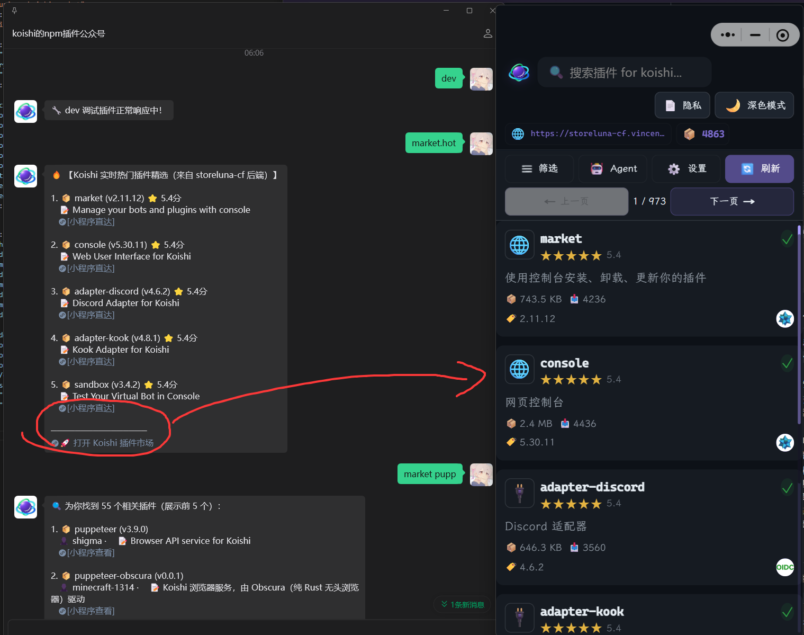

# koishi-plugin-adapter-wechat-official-vincentzyu-fork

[](https://www.npmjs.com/package/koishi-plugin-adapter-wechat-official-vincentzyu-fork)

适用于 Koishi 的微信公众号 (Wechat Official) 适配器 Fork 版本，基于 [@satorijs/adapter-wechat-official](https://github.com/satorijs/satori/tree/main/adapters/wechat-official) 演进，修复了官方版本中媒体素材上传、富文本超链接丢失、Token 异常处理等关键缺陷，全面增强公众号消息体验。

<p align="center">
  
</p>

## 主要特性与修复 (Compared to Upstream)

- 🔗 **支持富文本超链接与小程序直达**：
  - 完整支持 `h('a', { href }, children)`，渲染为微信支持的 `<a href="...">...</a>` 网页链接或小程序卡片链接。
  - 针对带有 `href` 属性的未识别元素进行降级容错渲染，防止包含复杂元素的指令输出被截断或丢弃。
- 🖼️ **图片与媒体上传修复与规范化**：
  - 将 Satori 的 `img` 元素类型统一规整为 `image`，彻底解决官方适配器调用微信素材上传接口时因类型不匹配导致上传失败的问题。
  - 修复微信上传素材 API 返回字符串格式响应时的解析崩溃问题，安全提取 `media_id`。
  - 媒体上传失败时优雅降级并输出告警，不会导致整个发送链路抛错中断。
- 🔄 **40001 Token 自动重试机制**：
  - 当调用微信上传接口遇到 `40001` (invalid credential / access_token expired) 错误码时，自动清理并刷新本地凭据后无缝重试，避免缓存未过期但微信端失效导致的发图失败。
- 🛡️ **被动回复与主动客服消息解耦**：
  - 针对各类媒体消息（图片、语音等）和文本超链接提供原生被动回复 XML 与客服消息通道双重保障。

## 配置说明

在 Koishi 工作区 `koishi.yml` 中配置：

```yaml
adapter-wechat-official-vincentzyu-fork:
  appid: your-wechat-appid
  secret: your-wechat-appsecret
  account: gh_xxxxxx # 公众号原始 ID
  token: your-webhook-token
  aesKey: your-encoding-aes-key
```

## 常见消息格式示例

### 超链接与小程序跳转

```ts
// 发送带超链接的消息（支持微信官方跳转或小程序）
await session.send(h('a', { href: 'https://example.com' }, '打开网页'))

// 或在模板中混合文本与链接
await session.send([
  '📦 插件推荐：',
  h('a', { href: 'https://uniapp-koishi-market.pages.dev/#/pages/plugin-detail/plugin-detail?name=market' }, '[小程序直达]'),
])
```

### 图片与语音消息

```ts
await session.send(h.image('https://example.com/demo.png'))
await session.send(h.audio('file:///path/to/voice.mp3'))
```

## 鸣谢

- 原始项目：[@satorijs/adapter-wechat-official](https://github.com/satorijs/satori/tree/main/adapters/wechat-official)
- 协议生态：[Koishi](https://koishi.chat/)
